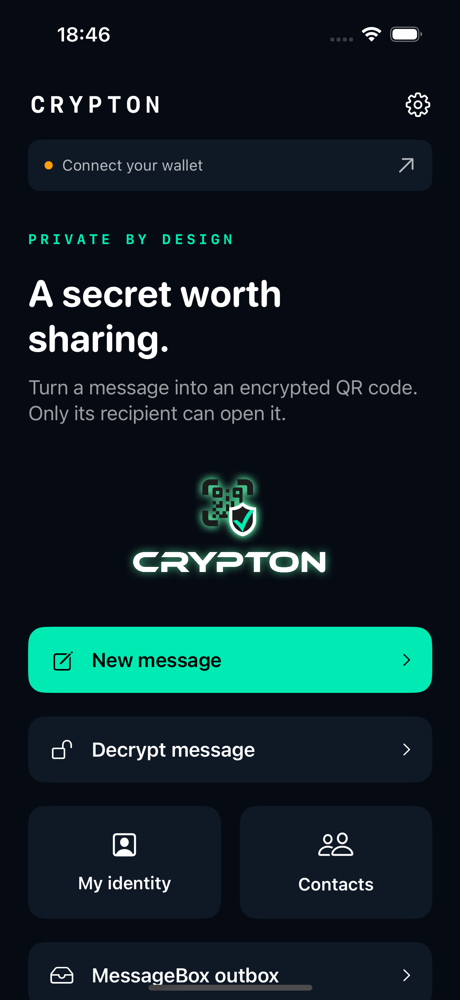

# Crypton for iOS

Native iOS port of [Crypton for Android](https://github.com/p2ppsr/crypton-android), built on the original [p2ppsr/crypton-ios](https://github.com/p2ppsr/crypton-ios) project. Crypton encrypts messages for a recipient, represents encrypted payloads as text or QR images, and opens messages using the recipient's wallet.

**The primary workflow is native Metanet Explorer (ME) for wallet operations, MessageBox for delivery, and Crypton for message encryption/decryption.** New installations select native ME and Crypton v2. Existing saved wallet settings are preserved.

The branch includes the SwiftUI application, native ME handoff, Android-compatible v2 engine, MessageBox inbox/outbox, optional disappearing messages, share extension, contacts and media import/export, and simulator tests. The original artwork and audio are retained.

Every UI/device test run is recorded as a private MP4. The simulator test runner captures automatically; see [recording runs and retaining error evidence](docs/RECORDING_RUNS.md) for manual runs and artifact locations.

**2.5.1 usability update:** combined contact QR/text, one-session composer sends, guarded native return, completed inbox statuses and itemized ME payment totals. See [the changes and verification](docs/WALLET_USABILITY_2_5.md). Requires the companion ME update below. Version 2.5.1 adds idempotent wallet-response acknowledgment and resumes ME after background recovery; human payment review no longer expires behind an open Pay prompt.

**2.4.1 wallet-flow update:** one ME page per operation, guarded automatic return, selectable BRC-116 permissions, persistent-grant ordering, fresh quote revalidation, and safe declined-payment recovery. Grouped native identity requires the [companion ME update](https://github.com/p2ppsr/metanet-explorer-mobile/tree/codex/crypton-wallet-usability). Compare the app pairing code in Crypton Settings with ME’s permission review. See [wallet usability and verification](docs/WALLET_USABILITY_2_4_1.md).



## Contents

- [Requirements and quick start](#requirements-and-quick-start)
- [Connect Metanet Explorer](#connect-metanet-explorer)
- [Understand the three identities](#understand-the-three-identities)
- [Find a recipient with SocialCert](#find-a-recipient-with-socialcert)
- [Send and receive messages](#send-and-receive-messages)
- [MessageBox inbox](#messagebox-inbox)
- [Disappearing messages](#disappearing-messages)
- [MessageBox fees and recovery](#messagebox-fees-and-recovery)
- [Contacts, QR codes and sharing](#contacts-qr-codes-and-sharing)
- [Legacy and nested messages](#legacy-and-nested-messages)
- [Other wallet connections](#other-wallet-connections)
- [Storage and implementation](#storage-and-implementation)
- [Build and test](#build-and-test)
- [Verification and limitations](#verification-and-limitations)
- [Troubleshooting](#troubleshooting)
- [Repository layout and credits](#repository-layout-and-credits)

## Requirements and quick start

| Component | Requirement |
| --- | --- |
| Application deployment target | iOS 16 or later; iPhone and iPad targets |
| Development | macOS with Xcode 16.4 or later and an installed iOS simulator runtime |
| Primary wallet | Installed, configured and unlocked Metanet Explorer on the same iPhone/simulator |
| MessageBox delivery | Network access and any wallet-approved funds required for the delivery |
| Full automated tests | Node.js plus the pinned disposable fixture dependencies listed below |

Clone this branch and open the project:

```sh
git clone --branch bob https://github.com/p2ppsr/crypton-ios.git
cd crypton-ios
open Crypton.xcodeproj
```

Select the **Crypton** scheme and an iPhone simulator, then Run. The shared scheme builds and embeds **CryptonShare** automatically. Install/configure ME separately for the live wallet workflow; the repository does not include a funded wallet or wallet credentials.

There are no CocoaPods or Swift package dependencies to resolve for the active application. The old `Podfile`, package resolution file and excluded UIKit/storyboard sources are retained as historical project material. The current app uses packaged engine resources and system frameworks.

## Connect Metanet Explorer

1. Open and unlock ME on the same iOS device or simulator.
2. In Crypton, choose **Settings → Wallet connection → Metanet Explorer → Save wallet connection** if another connection is currently selected.
3. Tap **Connect your wallet** or **Open wallet**.
4. Review the requested identity/protocol permission in ME and approve the access you intend to grant. Permission approval and payment approval are separate.
5. Tap **Return to Crypton** after the request completes. If that link does not open Crypton in your ME build, use the iOS app switcher to return.

Wallet-dependent operations can require several trips between Crypton and ME. Return to Crypton after each completed request so the next operation can begin from the foreground.

The native connection uses ME's `metanet://browser?url=…` route and CWI bridge. Crypton hosts a packaged request page on a temporary loopback listener. The ME wallet performs the approved operation and returns its result through that local bridge. Details are in [the native handoff notes](docs/ME_IOS_HANDOFF.md).

## Understand the three identities

These public keys serve different purposes:

| Identity | Where to find it | Purpose |
| --- | --- | --- |
| Crypton receiving key | **My identity**, with v2 selected | Give this to someone encrypting a v2 message for you. It is derived specifically for Crypton. |
| ME wallet identity | Included in **My identity** contact code; expandable under **Delivery wallet key** | Addresses your MessageBox inbox. The separate outbox key action remains available for older clients. |
| One-use sender key | The `sender` field of a v2 envelope | Generated freshly for each sealed message; used when decrypting that envelope. It is not your persistent MessageBox inbox address. |

**My identity** now shares one public contact code/QR containing both keys. Scan it from the recipient/contact screen, paste the code into the recipient field, or import the shared text/file. Review and explicitly save the contact to retain it. Selecting that contact fills encryption and delivery destinations together. The code is a shared address-book entry, not a certificate or proof of identity; verify it with the person who shared it.

Manual receiving-key entry and **Copy receiving key only** remain available for older clients. For MessageBox sends, also enter that recipient's delivery wallet key. Existing saved contacts and mappings continue to work. New contact exports carry both keys when known; older contacts without a delivery key still export as vCards.

The SocialCert search flow below instead selects a certified **wallet identity** for both encryption and delivery. V2's compatible wallet-decryption path opens these messages; the usual app-derived receiving-key workflow remains available.

When legacy mode is enabled, **My identity** instead shows the wallet identity used by the legacy format.

## Find a recipient with SocialCert

1. Choose **New message** and enter an email, social handle, name or compressed wallet public key in **Email, social handle or name**.
2. Tap **Search**. Typing alone sends no lookup. With native ME, complete the request and return to Crypton.
3. Review the returned name, certification label, wallet identity and expandable certifier public key. Choose **Use this recipient** explicitly; Crypton never selects the first match automatically.
4. Optionally choose **Save recipient contact** in the composer. This stores the public name/key and wallet-delivery mapping locally; it does not publish a certificate or write to your phone contacts. Saved contacts are address-book entries; search again to refresh certificate information.
5. Write and encrypt your message. **Send with MessageBox** prefills the selected wallet identity, including when you later reuse the saved contact. Fee review and payment approval are unchanged.

Search uses SDK `IdentityClient` over the connected wallet's `discoverByAttributes` or `discoverByIdentityKey` interface, following ME's Send & Receive implementation. The wallet performs discovery under its own trust configuration. Crypton neither changes trusted certifiers nor overrides their trust threshold. Results depend on publicly discoverable certificate fields; possessing a private SocialCert certificate alone does not guarantee a search match. Names and social handles are not unique, so compare the displayed keys and certification details before selecting.

One explicit search returns up to **20 certificates**. Refine the query for more specific results. Editing the query clears its previous results. Empty matches are distinguished from denied, unavailable or malformed wallet responses; cancelled searches cannot select a recipient. Search text and certificate results are held in memory. Saved contacts persist only when you choose to save them.

Native ME and compatible BRC-100 JSON wallets support this flow. The original portal does not implement certificate discovery. No certificate issuance, publication or payment is requested by recipient search. Existing manual key, QR and contact entry remains available. Contact export carries public receiving/delivery keys where available; it does not export certification evidence or mark the imported contact as newly certified.

See [Babbage's certificate/discovery guide](https://docs.projectbabbage.com/docs/guides/wallet/certificates), [the SDK identity reference](https://bsv-blockchain.github.io/ts-sdk/reference/identity/) and [Crypton's search verification with screenshot](docs/RECIPIENT_SEARCH.md). The automated search checks use disposable wallet responses and do not establish availability of the live SocialCert directory.

## Send and receive messages

### Send a v2 message

1. Select **New message** and choose **Myself**, a saved contact, a shared Crypton contact code, or an explicitly selected certified identity.
2. Write the message. A contact code fills the receiving and delivery wallet keys together; manual-key recipients must supply the delivery key separately.
3. Choose **Send with MessageBox** in the composer. Crypton encrypts locally and saves the delivery record, then checks and revalidates fees within one ME session.
4. Review the **full total in ME**, including the server/recipient fees and wallet costs. Approve the one-time payment only if it matches your intended send; a standing spending limit is optional and not required.
5. Keep ME open through submission. It returns automatically after completion. **SENT / Accepted by MessageBox** confirms server acceptance; recipient decryption is a separate check.

For text/QR sharing instead, choose **Encrypt message**. The separate quote/review route remains available from that result and for existing drafts. Errors and uncertain payments retain their recovery record; use that record rather than creating another payment.

Use **Myself** for both encryption and delivery when sending to your own active wallet. New v2 messages use a fresh one-use sender key. Keep your own plaintext copy if you need to retain it; an outgoing message for another recipient is intended to be opened by that recipient.

### Receive and decrypt

Use **MessageBox inbox → Refresh inbox → select message → Decrypt message** for native receiving. The selected ME wallet retrieves and decrypts messages directly. Refresh is manual; there is no background push subscription. You can also transfer a notification payload from ME or use the import paths below.

Crypton accepts encrypted payloads through:

- **Decrypt message** and the encrypted-text editor;
- **Import encrypted file**;
- **Import QR image** using the private system Photos picker;
- the camera QR scanner;
- the **Crypton** share extension in the iOS share sheet.

Choose **Decrypt message**, approve the wallet operation in ME when requested, and return to see the plaintext. V2 supplies its sender key in the envelope. Wrong recipients fail to decrypt.

Incoming shares are queued in the app's shared container. Open Crypton to import the next item. **Settings → Import next shared message** handles additional queued items. The share extension accepts encrypted text, validated public contact-code text or one selected image. Imported contact codes open a contact review; they are never saved or selected silently.

## MessageBox inbox

Choose **MessageBox inbox → Refresh inbox**, complete the ME requests and return to Crypton. Select a saved message and choose **Decrypt message**. The plaintext appears in the message view; full public sender/message identifiers are under **Delivery details**.

The inbox authenticates to the pinned MessageBox service, retrieves `notifications` in pages of 25, decrypts the outer MessageBox transport and saves only validated inner Crypton envelopes. **Load more messages** continues pagination. Storage is file-protected, excluded from backup, capped at 1,000 records per wallet, and partitioned by receiving wallet identity. Opening a saved message checks that ME still uses that wallet. Failed refreshes keep cached messages. Plaintext is not persisted.

**Dismiss on this device** hides a saved record locally. **Show dismissed messages → select message → Restore message** restores it. Neither action deletes the server notification. Normal refresh/decryption cannot acknowledge server messages, make payments or internalize attached recipient fees.

## Disappearing messages

Under **Settings → Disappearing messages**, select these independently; both default to **Keep copies**:

- **Sent: remove after confirmed delivery** captures the preference on each new delivery. After a matching MessageBox acceptance receipt, Crypton removes its encrypted outbox/payload/payment-journal copies and clears draft/result/recipient references and Crypton-owned clipboard content. Message export actions are unavailable in this mode. Uncertain payments retain recovery records and cannot start another payment. A definite pre-commit wallet refusal plus fresh empty history allows an explicit retry. A completed cleanup marker can be retried without spending again.
- **Received: decrypt once and remove** applies to inbox decryption. After successful decryption, Crypton atomically replaces local ciphertext with a minimal pending-removal record, automatically sends an authenticated acknowledgement, then verifies an ID-filtered lookup no longer returns the message. Only then does it report **Server removal confirmed**. Failed decryption never authorizes acknowledgement. Failed or uncertain deletion stays pending, cannot rehydrate ciphertext on refresh, and retries after closing the one-view result and on foreground/restart. Wallet permission/profile errors pause automatic prompts until the user refreshes/retries.

The private result and any nested layers are viewable in memory without saving a new envelope. Closing, leaving the view or backgrounding after viewing clears it. Copy/share/selectable plaintext are unavailable. A result completed while ME is foreground waits for the first Crypton view; process death can lose that one-view result. iOS app previews and captured-screen views are covered. iOS screenshot blocking cannot match Android's secure-window flag; this is not a promise of forensic erasure, removal of wallet/on-chain records, external copies or server backups.

Acknowledgement does not collect an attached recipient fee. Receive a wanted fee in ME first; deletion removes that notification's remittance data from Crypton's flow. No automatic funds import or financial transaction is authorized. Existing normal outbox records retain their original retention behavior when settings change.

## MessageBox fees and recovery

The native client uses `https://messagebox.babbage.systems` and the `notifications` inbox. It validates the authenticated delivery-agent identity and the quoted payment destinations before proceeding.

**The MessageBox quote covers the server and recipient fees. ME may add wallet storage and network fees. Review the full total in the wallet before approving.** A small MessageBox quote is not a promise of the same final wallet total. Production sending can spend real funds even when the applications run in emulators.

The encrypted outbox persists across app restarts:

| State | Meaning and next action |
| --- | --- |
| `DRAFT` | Encrypted message saved; obtain a quote. |
| `QUOTED` | Reviewed payment plan saved; send or refresh the quote. A changed/expired quote cannot authorize the previous payment plan. |
| `PAYMENT_REQUESTED` | The wallet may have started a payment. **Check wallet history**; this record cannot request another payment. |
| `PAYMENT_RETURNED` | A wallet transaction has been saved; resume delivery using that result. |
| `PAID` | Payment bytes and reviewed outputs have been validated. |
| `SUBMITTING` | Delivery may have reached MessageBox; retry with the saved transaction and message ID. |
| `SENT` | MessageBox returned an acceptance receipt. This does not mean the recipient opened the message. |

Crypton writes `PAYMENT_REQUESTED` **before** calling the wallet's `createAction`. Once payment might have started, the same record cannot create a second payment. Returned transaction data is saved before delivery processing continues.

If a wallet response is lost, history recovery looks for this delivery's labelled transaction. For one matching completed payment, Crypton can retrieve its confirmed public transaction and Merkle proof, check the proof against its block root, validate the reviewed outputs, and save the recovered transaction for resubmission. Public proof retrieval uses the fixed Whatsonchain mainnet API. If confirmation or proof is unavailable, keep the record and retry recovery later. An empty history response does not prove cancellation.

If sending is interrupted, use the existing outbox record and **Retry delivery with saved payment** where available. Avoid creating a replacement paid draft merely because an earlier send has no visible receipt yet.

## Contacts, QR codes and sharing

- Save a contact name and compressed public key; native validation checks the secp256k1 point.
- Import a selected phone contact with its key in a URL or instant-message field. The importer accepts a bare key or `crypton:<public-key>`.
- Export contacts as vCards and delete saved Crypton contacts from the contact list.
- Generate QR images for identities and encrypted output. If the payload exceeds QR capacity, share encrypted text instead.
- Import QR images through Photos or Files. PNG/JPEG file handling and a genuine HEIC Photos import are covered by tests.
- Use **Copy text**, **Share text**, **Share QR image**, **Save to Files**, and **Save Image** where iOS offers them.

The Photos picker provides only the selected image. Saving QR images uses the separate add-only Photos permission. Other destinations depend on the applications, accounts and devices configured in iOS.

Music and effects can be disabled in **Settings → Music and sound effects**. Muting or backgrounding releases the app's players. Interruption handling respects the mute setting, foreground state and the system's permission to resume playback.

## Legacy and nested messages

Enable **Settings → Legacy iPhone message format** for the original raw-base64 format. Legacy messages use the wallet identity, protocol `[1, "crypton"]`, key ID `"1"`, and UTF-8 plaintext transported as base64. Both people must use the corresponding wallet identities. Raw ciphertext contains no sender identity, so Crypton requires explicit sender selection before decrypting it, including after file import.

V2 uses protocol `[2, "crypton"]`, key ID `"1"`, an app-derived receiving identity and a one-use sender. Its envelope has exactly these fields:

```json
{
  "protocol": "crypton",
  "version": 2,
  "ciphertext": "<base64 ciphertext>",
  "sender": "<compressed one-use public key>"
}
```

The envelope contains no public recipient field. App-derived decryption is attempted first, followed by the compatible wallet-root fallback. The protocol engine matches the Android implementation.

Nested encrypted content opens one layer at a time. After opening an outer layer, Crypton shows its note and encrypted inner envelope. **Open inner layer** explicitly imports that envelope for the next decryption. The UI supports opening nested content; it does not add a separate nested-message composer.

## Other wallet connections

| Connection | Role and status |
| --- | --- |
| **Metanet Explorer (Bob)** | Separate iOS wallet app selected explicitly in Settings; uses `metanet-bob://` and never falls back to the official wallet. |
| **Metanet Explorer** | Default and primary workflow; live emulator delivery/decryption verified in both directions. |
| **BRC-100 JSON** | Optional direct API connection for a compatible wallet exposing an HTTPS JSON endpoint. SDK-backed loopback integration is tested. |
| **Original portal** | Legacy compatibility option for `https://mobile-portal.babbage.systems`. Its TLS connection failed during testing; live portal login/messaging remains unverified. |

For JSON mode, choose **Settings → Wallet connection → BRC-100 JSON**, enter the endpoint and save. Requests identify the app as `https://crypton.ios` through Origin/Originator headers. Release endpoint configuration requires HTTPS. Debug builds additionally allow explicit localhost/`127.0.0.1` ports for disposable fixtures. Redirects are rejected, response sizes are bounded and cookies are not used by the JSON transport.

The original portal adapter preserves the historical `iOS_<bundle identifier>` originator and UUID-correlated callbacks. It is not required by the native ME workflow. Selecting it enables the legacy format; selecting and saving ME or JSON selects v2.

## Storage and implementation

| Data | Handling |
| --- | --- |
| Wallet root private keys | Remain in the external wallet. |
| App-derived receiving material and ephemeral sender keys | Held in the isolated engine's memory; not saved as key files by Crypton. |
| Plaintext drafts and decrypted results | In memory; cleared by **Done** or **Clear wallet session**. |
| Public contacts, wallet connection and delivery-key mappings | Persist in application preferences. |
| Encrypted outbox, saved payment data and receipts | Atomic, file-protected application storage excluded from backup; confirmed disappearing sends remove them. |
| Received messages | Encrypted, wallet-scoped and file-protected; private decryption replaces ciphertext with a minimal deletion-retry record before server removal. |
| Incoming shared encrypted payloads | File-protected App Group queue, excluded from backup; consumed on successful import. |

Clearing a wallet session retains contacts and the outbox and does not sign the external wallet out. OS file protection can make protected records unavailable while a physical device is locked; hardware-specific behavior was not validated in simulator QA.

The engine runs only packaged assets in a nonpersistent WKWebView with a restrictive CSP. JavaScript has no direct network path: native code validates wallet methods, counterparties, delivery hosts, payment arguments and HTTP requests. The ME listener binds to loopback, uses a fresh 256-bit capability for each request, validates response UUID/Origin/Host, and closes after completion or cancellation. Wallet results do not travel in callback URLs.

Wallet requests are bounded to five minutes, enclosing engine operations to fifteen minutes, and SDK authentication handoffs to ten minutes. HTTP has separate request/resource deadlines. Ending iOS's finite background-task window preserves the pending response until foreground return or the request deadline. No background audio mode is used to keep the wallet bridge alive.

The packaged `@bsv/sdk` is **3.2.1**. Two authentication deadlines are adapted for iOS handoffs; see [the SDK patch notes](Crypton/Engine/vendor/CRYPTON_PATCHES.md).

## Build and test

### Simulator build

```sh
xcodebuild -project Crypton.xcodeproj -scheme Crypton \
  -destination 'generic/platform=iOS Simulator' \
  -derivedDataPath /tmp/crypton-ios-build CODE_SIGNING_ALLOWED=NO build
```

### Device signing and unsigned Release build

For a physical device, select your own development team for **Crypton** and **CryptonShare** and provision the same App Group on both targets. The current identifiers are:

- app: `com.projectbabbage.Crypton`;
- extension: `com.projectbabbage.Crypton.Share`;
- App Group: `group.com.projectbabbage.Crypton`.

If changing the App Group, update both entitlements and `IncomingShareStore.group`. Device provisioning and physical-device execution remain to be verified by the installing developer.

```sh
xcodebuild -project Crypton.xcodeproj -scheme Crypton -configuration Release \
  -destination 'generic/platform=iOS' \
  -derivedDataPath /tmp/crypton-ios-release CODE_SIGNING_ALLOWED=NO build
```

### Automated tests

```sh
scripts/test-ios.sh
```

The runner creates or reuses only a simulator named **Crypton-iOS-Test**, disables parallel tests, and uses ad-hoc signing to exercise the share extension. SDK-dependent tests report skips when their fixture is unavailable.

For the complete fixture-backed suite:

```sh
npm install --prefix /tmp/crypton-sdk --ignore-scripts --no-audit --no-fund \
  --package-lock=false @bsv/sdk@3.2.1 @bsv/auth-express-middleware@2.2.9 express@4.21.2

CRYPTON_SDK_ROOT=/tmp/crypton-sdk \
CRYPTON_DERIVED_DATA=/tmp/crypton-ios-tests \
CRYPTON_RESULT_BUNDLE=/tmp/crypton-ios-tests.xcresult \
scripts/test-ios.sh
```

Choose a new result-bundle path for each run. The script stages the public HEIC fixture, starts loopback services on ports **18776** and **18777**, runs the independent bundled-engine interoperability check and Xcode tests, then stops its fixture process. Those ports must be available. Node.js 22 is used by the checked-in CI workflow.

Additional Xcode arguments are forwarded, for example `scripts/test-ios.sh -only-testing:CryptonTests/MEAndDeliveryIntegrationTests/testPrivateMessageClearsOnBackgroundAndRemovalRetriesAfterRestart` for a focused restart check with the same fixtures and simulator isolation.

An additional installed ME Bob handoff check is opt-in and excluded from the default 47 cases. Install Bob on the dedicated test simulator, start `node scripts/me-bob-launch-fixture.cjs`, and dispatch `metanet-bob://browser?url=http%3A%2F%2Flocalhost%3A18778%2Ftest%2Fbob-route-check` to that device. Then run the test runner with `OTHER_SWIFT_FLAGS=-DME_BOB_SMOKE_TEST -only-testing:CryptonUITests/CryptonUITests/testInstalledBobSchemeHandoff`. Stop the static fixture afterward. It checks OS routing and actual page rendering without wallet APIs or account creation.

Fixtures use disposable SDK wallets and synthetic transactions. They do not access installed ME profiles, broadcast transactions or spend real funds. Explicit Debug-only test arguments isolate the test share inbox and payment journal; the fixture delivery override is compiled out of Release.

[GitHub Actions](.github/workflows/ios.yml) runs the fixture-backed tests and an unsigned iPhone build on pushes and pull requests. A local passing run does not imply the hosted workflow has already passed for a newly pushed commit.

## Verification and limitations

Automated verification on **31 October 2026**; installed-wallet live interoperability checks on **30 October 2026**:

| Check | Result |
| --- | --- |
| Native/integration tests | 31 unique cases passed |
| UI tests, including native inbox, retention, recipient search, Files/Photos/HEIC, nested content, sharing and force-quit recovery | 16 passed |
| Total fixture-backed coverage | **47 unique cases passed; no skips**, across the full run and focused verification described in the parity report |
| Certified recipient search, selection, contact saving and delivery prefilling | Passed with disposable wallets, including the native ME page/CWI path |
| Standalone bundled-engine/independent SDK interoperability | Passed |
| Independent inbox driver, including authenticated removal and failure recovery | Passed |
| Installed ME Bob app launch and Bob-only native browser handoff | Additional opt-in simulator case passed with a disposable static page |
| Simulator and unsigned iPhone Release builds | Passed |
| Installed iOS ME → production MessageBox → Android ME → Crypton decryption | Passed on emulators |
| Reverse Android → iOS MessageBox delivery and native ME decryption | Passed on emulators |
| Legacy messaging between installed ME wallets | Passed in both directions |

The live checks used separately reviewed wallet permissions and manually approved payments. They are distinct from the automated, unfunded fixtures. Wallet-specific receipts and raw local handoff experiments are not published in this branch.

Known boundaries:

- The original portal failed TLS setup in the test environment; its login and message operations remain unverified.
- Live SocialCert directory lookup through an installed ME wallet profile remains unverified; the automated discovery fixture models the wallet's already-validated certificate results.
- The new native inbox and automatic removal are verified against authenticated disposable MessageBox fixtures. Production retrieval/removal through the newly built iOS ME Bob wallet has not been exercised; the earlier live delivery/decryption checks used the previous workflows. Private iOS views cover previews and hide during capture, but cannot block screenshots.
- Phone-contact/vCard and clipboard round trips were exercised. Reminders received a test draft; print and Watch flows opened previews. Completing account-backed sharing, real printing and Watch installation was not verified.
- Insufficient funds, denied permissions, changed quotes, dropped connections and process termination during payment were tested with disposable wallets. Those failures were not induced on the funded production wallets.
- Audio tests use real simulator players and simulated interruption notifications. Physical camera scanning, cellular interruptions, device locking/provisioning and a full iPad/device matrix remain outside emulator coverage.

See [Android 2.4 parity and retention details](docs/ANDROID_PARITY_2_4.md), [recipient-search verification](docs/RECIPIENT_SEARCH.md), [port verification](docs/PORT_VERIFICATION.md), [remaining-functions QA](docs/REMAINING_FUNCTIONS_QA.md) and [native ME handoff](docs/ME_IOS_HANDOFF.md) for more detail.

## Troubleshooting

| Symptom | Action |
| --- | --- |
| ME does not open | Install/configure/unlock ME on the same device and select the native ME connection in Crypton. |
| Return link has no effect | After ME finishes, return using the iOS app switcher. |
| Wallet request times out | Return to Crypton and retry; if payment may have started, use the existing outbox record's recovery action. |
| MessageBox notification never arrives | Check the recipient's **wallet identity** separately from the Crypton receiving key; check whether the outbox has an acceptance receipt. |
| Ciphertext will not open | Use the intended recipient wallet, retain the complete envelope, and check permissions. Legacy ciphertext additionally needs the sender's wallet identity. |
| Final wallet total exceeds the quote | Review ME's storage/network charges as well as the MessageBox server/recipient fees. |
| Recovery has no public proof yet | Keep the uncertain record and retry after confirmation; do not create a replacement payment solely because history/proof is incomplete. |
| Shared item is not imported immediately | Open Crypton, finish/cancel any active operation, then use **Import next shared message**. |
| QR exceeds capacity | Share the encrypted text or save it to a file. |
| Original portal reports an SSL error | Use the verified native ME workflow; the legacy portal requires separate TLS/service diagnosis. |
| Fixture tests fail to start | Check Node dependencies, an available iOS runtime and free loopback ports 18776/18777. |

## Repository layout and credits

```text
Crypton/Native/          SwiftUI model/screens, wallet adapters, QR/media helpers,
                        bounded HTTP, native ME listener and durable outbox
Crypton/Engine/          Packaged v2/delivery engines and ME request page
Crypton/Engine/vendor/   Pinned SDK bundle, patch notes, licenses and notices
Crypton/Shared/          Incoming App Group share queue
CryptonShare/           iOS share extension
CryptonTests/           Native, SDK, bridge and payment tests
CryptonUITests/         Simulator UI and extension round trips
scripts/               Test runner, disposable wallet/MessageBox fixtures,
                        interoperability check and public HEIC fixture
docs/                  Architecture, coverage and synthetic UI screenshots
```

The original project supplies application identity and assets; the Android implementation supplies current protocol behavior. Historical UIKit/storyboard files are retained but excluded from the active build.

Bundled SDK licensing and attribution are retained in [the vendor directory](Crypton/Engine/vendor/), including [third-party notices](Crypton/Engine/vendor/THIRD_PARTY_NOTICES.md) and [SDK license](Crypton/Engine/vendor/LICENSE.txt).

Music: **“Phantom from Space” — Kevin MacLeod**, [incompetech.com](https://incompetech.com/), licensed under [CC BY 4.0](https://creativecommons.org/licenses/by/4.0/). Original audio files are unchanged.
