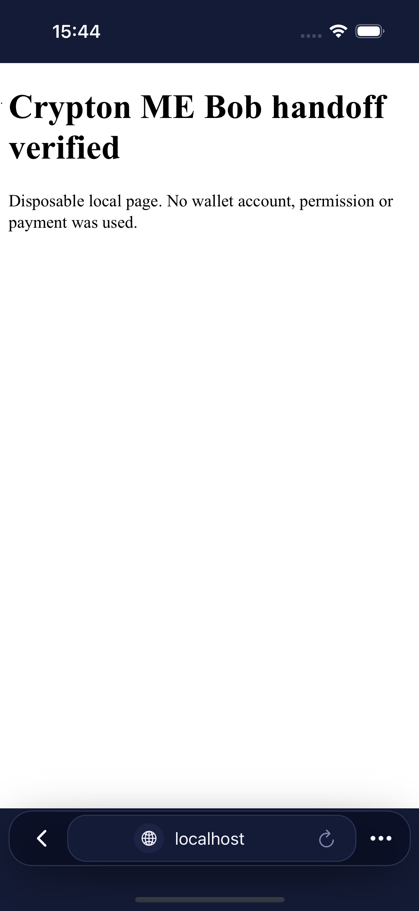
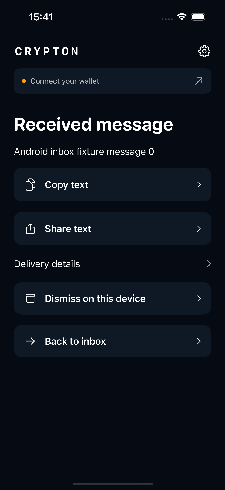
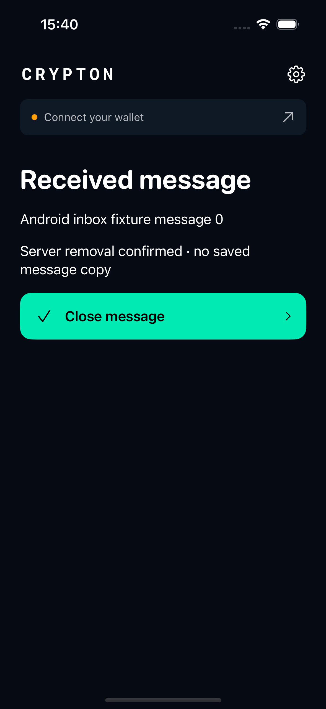

# iOS parity with Crypton Android 2.4.0

31 October 2026. Reviewed the latest **Crypton-Android** chat and Android commit `f5e5a79` (native inbox plus optional disappearing messages), including the preceding ME Bob selection and discovery fixes. The Android checkout and its unfinished funding diagnostics were left unchanged.

## Feature mapping

| Android functionality | iOS behavior |
| --- | --- |
| Native MessageBox inbox | Manual authenticated refresh, pages of 25, encrypted saved copies, wallet-profile binding, direct decryption, read flags and local dismissal/restoration. |
| Independent sent/received retention | Two settings, both off by default. Sending preference is captured per new delivery; receiving preference applies when opening an inbox message. |
| Disappearing sends | Matching server acceptance replaces the outbox with a minimal cleanup marker, then removes it. Memory/owned clipboard references clear. Uncertain payments remain recoverable and cannot create a second payment. |
| Disappearing receives | Successful decryption replaces saved ciphertext with a five-field removal record, automatically acknowledges that exact ID, authenticates an ID-filtered lookup and requires absence before reporting removal. |
| Recovery and retries | Pending removal survives restart without sender/body/plaintext, cannot rehydrate on refresh, retries in foreground after closing the private result, and pauses on wallet/profile/permission errors. |
| One-view and nested content | Private plaintext and inner layers remain in memory. Close, navigation away or backgrounding after viewing clears them. A result arriving during a wallet handoff waits for its first view. |
| ME Bob selection | Explicit `metanet-bob://` transport, with no automatic fallback to `metanet://`. The separate Bob bundle/app group preserves the official app and account. |
| Screenshot/privacy behavior | UIKit snapshot cover on inactive scenes; private SwiftUI views hide during recording/capture. iOS does not provide Android's `FLAG_SECURE` screenshot guarantee. No private UIKit secure-text-field hacks are used. |

The packaged `inbox.js` and `engine.js` are copied from the reviewed Android implementation. The v2 envelope, protocols, app-derived/root decryption and ephemeral sender behavior are unchanged. The inbox driver uses the same authenticated acknowledgement and absence-verification rules. Native iOS code independently restricts its wallet methods, HTTP endpoints and checkpoints.

SHA-256: `engine.js` = `059c26610de27d2045ca59d34f50b68a057eda737a2223bbbc8c4cf2068baedb`; `inbox.js` = `bf7e3970a17a403c32ed2390cbf66944bedd5ce871e08b6f311614a08399a433`.

## Data and authorization

Normal inbox records are atomic, file-protected, excluded from backup and partitioned by receiving wallet. At most 1,000 saved records per wallet and 25 records per network page are accepted. Duplicates preserve flags; conflicting records do not replace saved envelopes. Retrieval failures keep the local inbox. Refresh/open cannot spend, internalize fees, send a message or acknowledge arbitrary IDs.

Only a successful disappearing decryption can atomically arm removal. The retry record has exactly `version`, `wallet`, `host`, `messageId` and `state: REMOVAL_PENDING`. Removal sessions can acknowledge only that persisted ID. Neither an acknowledgement error nor a nominal successful acknowledgement proves removal: a subsequent authenticated lookup must show the message absent, without unrelated IDs or an incomplete/multipage result.

Received private content is not stored in preferences, files or scene-restoration state. Copy/share/selectable plaintext are unavailable. Sender exports are unavailable in disappearing mode. Crypton creates QR images in memory rather than maintaining Android-style QR cache files; already exported Files/Photos/other-app copies remain outside these controls. Clipboard cleanup affects only Crypton-tagged items.

This is logical removal of app-owned saved copies and the active server inbox entry. It does not erase wallet/on-chain records, storage remnants, server backups or copies on other devices. Acknowledgement does not collect attached recipient fees; receive wanted fees in ME first. No funded transaction or production deletion was performed by the disposable tests.

## ME iOS compatibility

The official ME source previously returned empty discovery results before running the browser lookup. The Android-approved restoration and profile-specific cache fix also apply to iOS because the WebView router is shared. An isolated ME checkout includes that fix and adds explicit Bob iOS preparation: separate bundle identifier, URL scheme and app group, plus Firebase-disabled startup matching the separate Android Bob build.

The official wallet is neither uninstalled nor cleared. A Bob wallet requires its own sign-in/recovery; Crypton does not migrate private wallet state. Simulator packages do not establish physical-device provisioning or App Store/TestFlight distribution.

ME changes and reproducible build instructions are on [codex/ios-wallet-parity](https://github.com/p2ppsr/metanet-explorer-mobile/tree/codex/ios-wallet-parity/docs/qa/ios-bob-crypton.md). The generated Bob native project, Pods, dependencies and build products are kept outside this Crypton repository.

## Verification

Run `scripts/test-ios.sh` with the pinned SDK fixture dependencies from the README. The runner executes the independent v2 and inbox drivers, starts authenticated loopback services, and uses only **Crypton-iOS-Test**. Synthetic payment transactions are never broadcast. UI inbox storage has its own Debug-only test directory; production saved inboxes are preserved.

The new checks cover encrypted persistence and profile isolation, bounded pagination, root/app-derived opening, local dismissal/restoration, payment/import rejection, premature acknowledgement rejection, confirmed removal, rejected/lost/false-success acknowledgements, failed decryption, nested content, restart retries, one-view clearing and confirmed-send cleanup with uncertain-payment protection.

Results on 31 October: **47 unique simulator cases passed** (31 native/integration and 16 UI), with no skips. The full run passed 46 cases; its restart test checked the status label immediately after the storage checkpoint, before the asynchronous model completion. That test now asserts the pending record exists on restart and waits for operation completion before checking the final status. Its focused rerun passed. No production fix was needed for that assertion race. The independent v2 interoperability and inbox-driver suites passed, as did the final unsigned iPhone Release build.

The restored ME router passed its ten discovery regressions, the optional-Firebase startup check and Bob configuration/App Group isolation checks. Its universal iOS Simulator Release build passed with embedded Bob bundle/scheme/Firebase settings verified. Native inbox/removal against the production service and authenticated operations in the newly built Bob wallet remain unverified; the new end-to-end tests use disposable authenticated services and SDK wallets.

An additional opt-in installed-wallet UI test passed on **Crypton-iOS-Test**: native Bob launch reached the welcome screen, the OS resolved `metanet-bob://` to **Metanet Explorer (Bob)**, and its real browser rendered a disposable static loopback page. This case is outside the default 47 and is compiled only with `ME_BOB_SMOKE_TEST`. It did not exercise wallet authentication or CWI wallet calls; those integration cases use the SDK-backed ME request-page fixture above.

The two new inbox UI cases also passed a focused rerun with retained screenshots, reviewed at full size. Both show synthetic content, with readable message text and no clipping. The private view displays confirmed server removal and exposes only Close message, with copy/share absent.

| Normal saved message | Private one-view message |
| --- | --- |
|  |  |
