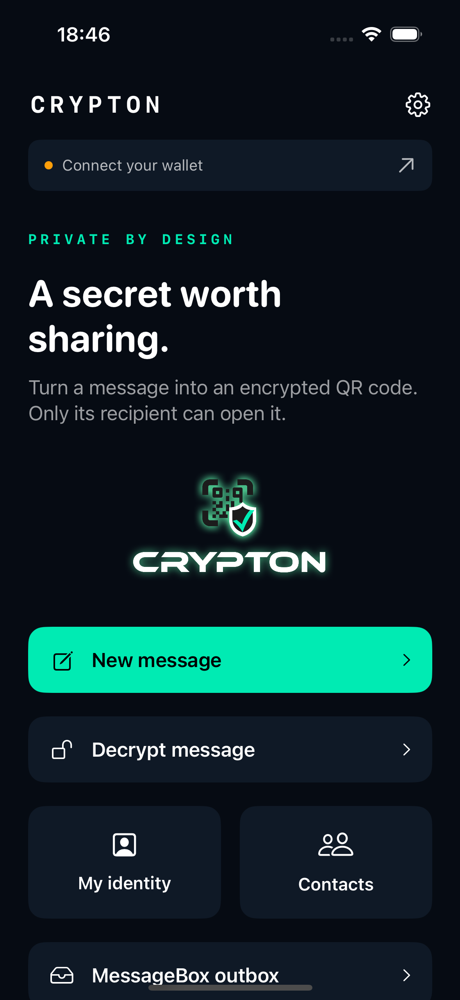
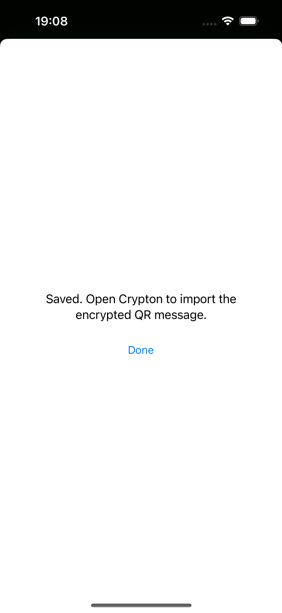

# iOS port verification — 30 October 2026

The current Android working tree at `p2ppsr/crypton-android` was the behavior source. The existing `p2ppsr/crypton-ios` checkout supplied the iOS project, application identity, original portal contract, artwork and sound assets. Android sources were read only.

## Results

Environment: Xcode 16.4; dedicated **Crypton-iOS-Test**, iPhone 16 simulator running iOS 18.6. Automated tests use disposable fixtures, with no real wallet profile, account, identity or funds. The separate live emulator test below used the installed ME wallets and an operator-approved payment.

| Check | Result |
| --- | --- |
| Simulator Debug build, including share extension | Passed |
| Unsigned iPhone Debug build | Passed |
| Optimized unsigned iPhone Release build | Passed |
| Native protocol/model/outbox/QR/WebKit/audio/file tests | 11 passed |
| ME loopback, capability, foreground return and shared-container tests | 5 passed |
| ME page crypto, authenticated payment/delivery recovery and failure handling | 3 passed |
| Independent SDK wallet HTTP integration | 1 passed |
| Native UI, nested messages, Files/Photos/HEIC, sharing and force-quit recovery | 11 passed |
| Standalone bundled-engine vs SDK interoperability | Passed |
| Shell runner syntax and Git whitespace check | Passed |

The final remaining-functions audit passed **31 tests with no failures or skips** (20 native/integration and 11 UI), with a fresh disposable wallet and a genuine HEIC fixture. The standalone interoperability check and final unsigned Release build also passed. The installed live iOS app again decrypted the actual Android reply through ME. Production messaging and legacy compatibility passed in both directions. [The follow-up QA report](REMAINING_FUNCTIONS_QA.md) records coverage, fixes, the original portal's TLS failure and hardware/account-dependent sharing limits.

Native tests exercise exact v2 envelope keys and version, public recipient-metadata rejection, secp256k1 field/curve validation, UTF-8/base64 transport, strict integer byte validation, malformed wallet responses, endpoint restrictions, explicit legacy sender selection, public contact persistence, draft clearing, QR generation/image reading and oversize fallback. Actual WebKit tests run the bundled engine with ephemeral sender keys, self decryption and wrong-recipient failure.

The loopback SDK fixture exercises the native HTTP transport with `@bsv/sdk@3.2.1`: independent recipient decryption, incoming app-derived and root wallet identities, nested content, Unicode, both legacy directions, denied wallet requests and refused redirects. It never connects to real accounts or creates production payments. The fixture starts on `127.0.0.1:18776` and the checked-in runner stops its own fixture on exit.

Native payment integration uses the shipped ME page, loopback listener and CWI bridge contract to the independent SDK/MessageBox fixtures. It obtains an authenticated quote, creates a synthetic transaction, loses a delivery response, reuses the same saved payment/message ID, loses a wallet payment response and finds its labelled transaction without issuing a second payment. Synthetic transactions are never broadcast.

Outbox tests verify the durable `PAYMENT_REQUESTED` write before a wallet request, rejection of changed payment details, refusal to create a second payment after reopening the store, recovery-only behavior for uncertain payments and rejection of off-host delivery requests. These checks do not claim production delivery or expenditure of real funds.

UI tests cover the native home screen, compose draft, legacy sender gate, contact creation, settings and real share-extension text/QR-image round trips through the simulator App Group. Shared payloads are decrypted and compared to the original synthetic plaintext. The home screenshot was inspected and the narrow action tiles corrected. Image imports use Core Image with a software context: the initial Vision decoder could not create an inference context in this simulator, and the replacement passes a real generated-image round trip.

The engine source is byte-for-byte identical to the current Android `engine.js`. Delivery JavaScript also compares quote fields by value, so iOS JSON key ordering cannot invalidate an unchanged quote. Share-sheet payloads travel with the presented item, and image providers are decoded as UIKit images and encoded as PNG before staging, rather than saving a UIKit archive as if it were a PNG.

```text
engine.js SHA-256
226ead02a81ebfe09e73c976929e45443a15f83f53aca46f438a859ce475d0cb

vendor/bsv-sdk-3.2.1.js SHA-256 (iOS handoff deadlines; see vendor/CRYPTON_PATCHES.md)
1f29b2d7644bd62950bede1e0b1b8847ee6432821b569d3c1c396a70150f466e
```

## Live cross-platform verification

Installed Crypton and Metanet Explorer applications on iOS and Android emulators were used for production MessageBox sends in both directions. The receiving ME wallet displayed each notification; its enclosed encrypted payload was imported into Crypton and decrypted with the receiving wallet. The decrypted text matched the sent text exactly.

A lost iOS wallet response was recovered by finding the labelled completed transaction, checking its confirmed Merkle proof against the block root and validating the reviewed payment outputs. Delivery resumed with the existing payment and reached `SENT` with a matching receipt, without creating a second payment. Separate installed-wallet legacy messages also decrypted in both directions, with explicit sender selection for raw ciphertext.

Live permissions and payments were reviewed separately from the automated fixtures. Wallet-specific receipts, notifications, transaction artifacts and raw handoff experiments are excluded from the published branch.

The live checks exposed short SDK authentication deadlines and iOS background-task expiry during wallet review. Authentication deadlines are ten minutes, individual wallet requests five minutes and enclosing operations fifteen minutes. Background-task expiry preserves pending replies until foreground return or the request deadline. Muting/backgrounding Crypton stops and releases its audio players; follow-up tests verify interruption handling as well.

## Reproduce

Run `scripts/test-ios.sh` from the repository on a Mac with Xcode and an available iOS simulator runtime. For the independent SDK checks, install `@bsv/sdk@3.2.1` in a disposable directory and set `CRYPTON_SDK_ROOT` to it. The script refuses to reuse unrelated simulator names. Without a running SDK fixture, the HTTP integration test reports an explicit skip.

The GitHub Actions workflow has been added but has not been run remotely in this chat.

## Scope and reproduction

The operator explicitly requested emulator-only work. Simulator tests use ad-hoc signing, not a physical-device provisioning profile. The automated fixtures use no real wallet permissions, production MessageBox payments or real funds. The separate live checks above used reviewed messaging access and manually completed payments. Physical camera/provisioning checks remain outside this emulator-only scope.

The implementation's ME route/CWI contract is checked against the actual local wallet source. The WKWebView harness runs Crypton's exact packaged ME page; it does not claim an installed ME app with a live user profile. Some ME builds restrict external callback schemes, so returning with the iOS app switcher is supported and separately tested.

Run `CRYPTON_SDK_ROOT=<runtime with SDK and auth middleware> scripts/test-ios.sh` for the full suite. The runner starts loopback fixtures, signs the simulator app/extension ad hoc, uses only **Crypton-iOS-Test**, disables parallel test execution and cleans up its fixture process. Incoming UI-test shares use a separate disposable inbox; production incoming shares are preserved.

The workflow installs `@bsv/sdk@3.2.1`, `@bsv/auth-express-middleware@2.2.9` and `express@4.21.2`. It has not been run remotely in this chat.




