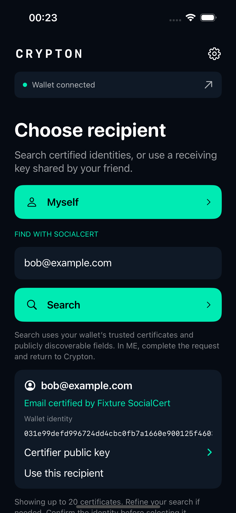

# Certified recipient search — 31 October 2026

Crypton follows Metanet Explorer's Send & Receive identity lookup: explicit user search through SDK `IdentityClient.resolveByAttributes({ attributes: { any: query } })`, or `resolveByIdentityKey` for a compressed public key. The native ME route and compatible BRC-100 JSON wallets expose the underlying discovery operations. The original portal is unsupported.

## Selection and messaging

Typing does not make a wallet request. Search trims the query, rejects invalid/control-character input and uses one bounded lookup with `seekPermission: true`, limit 20 and offset zero. The wallet supplies discovered certificates under its configured trust policy; Crypton cannot override certifiers or the trust threshold. Only publicly discoverable fields can match.

The packaged SDK formats names and certification labels. Crypton presents the wallet identity and expandable certifier public key beside each result. Neither a successful lookup nor a single match selects a recipient. The user chooses **Use this recipient**. Editing the query invalidates the old results, and a stale result cannot be selected through the model.

For a selected discovered identity, v2 encrypts to that wallet public key. The existing recipient engine's wallet-decryption fallback opens this format on iOS and Android. Its envelope, ephemeral sender and protocol identifiers are unchanged. MessageBox uses the same selected wallet identity, ahead of any obsolete manually saved delivery-key mapping. Manual app-derived receiving-key entry remains supported.

**Save recipient contact** stores only the public name, receiving key and wallet-delivery key in Crypton's local address book. Existing contacts decode without migration because the new delivery identity is optional. The certification label is not persisted as an ongoing assertion of validity. Reusing or exporting a contact does not issue a certificate, publish identity information, or refresh certificate status.

## Boundaries

Native code authorizes the exact method and arguments for the active search and accepts only one discovery invocation. Discovery has no authorized delivery session, so it cannot request a MessageBox payment. Requests cannot opt out of permission seeking, change the query, inject certifier/trust overrides or increase the result limit. Native transports bound response size and validate public keys, certificate metadata and lookup-subject consistency before SDK formatting. The isolated engine has no direct network access.

Empty matches, wallet denial, offline/invalid responses and cancellation are separate outcomes. A failed lookup is an error rather than an empty successful result. Cancellation closes the listener and discards pending results. Search text and result metadata stay in memory; contacts persist only on explicit save. Results contain no fetched remote avatar resources.

## Verification scope

The full expanded suite passed **36 tests with no failures or skips**: 23 native/integration tests and 13 UI tests. The standalone bundled-engine/SDK interoperability check and unsigned iPhone Release build also passed. The original v2 engine and vendored SDK hashes are unchanged.

Visual review found automatic hyphenation in wrapped public keys. Search-result keys now use an exact, horizontally scrollable line; the two search UI tests passed again after that adjustment, as did the final unsigned Release build.

The screenshot contains a disposable public key and an `example.com` address. It does not show a live SocialCert certificate or wallet profile.

The emulator integration tests run Crypton's shipped ME request page, loopback server and CWI transport against disposable SDK-backed wallets. The fixture models a wallet's already-validated discovery response; its synthetic certificates are not issued by SocialCert and are never published. Certificate signature/revocation checking and trust decisions remain the connected wallet's responsibility, as in ME's own recipient search.

Tests exercise explicit search, ambiguous matches, key lookup, empty results, permission denial, offline responses, malformed public keys, cancellation, query editing, explicit selection, contact persistence, obsolete delivery mappings and exact decryption by the selected recipient. UI tests cover search, selection, contact saving, encryption and MessageBox prefilling. No real MessageBox send or payment is needed for these checks.

Live SocialCert directory availability and end-to-end lookup using an installed ME wallet profile have not been established by the disposable fixtures. The prior production MessageBox delivery tests are documented separately in [port verification](PORT_VERIFICATION.md).

## References

- [Babbage certificate and discovery guide](https://docs.projectbabbage.com/docs/guides/wallet/certificates)
- [SDK identity interface](https://bsv-blockchain.github.io/ts-sdk/reference/identity/)
- [Metanet Explorer mobile source](https://github.com/p2ppsr/metanet-explorer-mobile/blob/master/app/send.tsx)
- [Usage and test reproduction](../README.md#find-a-recipient-with-socialcert)
